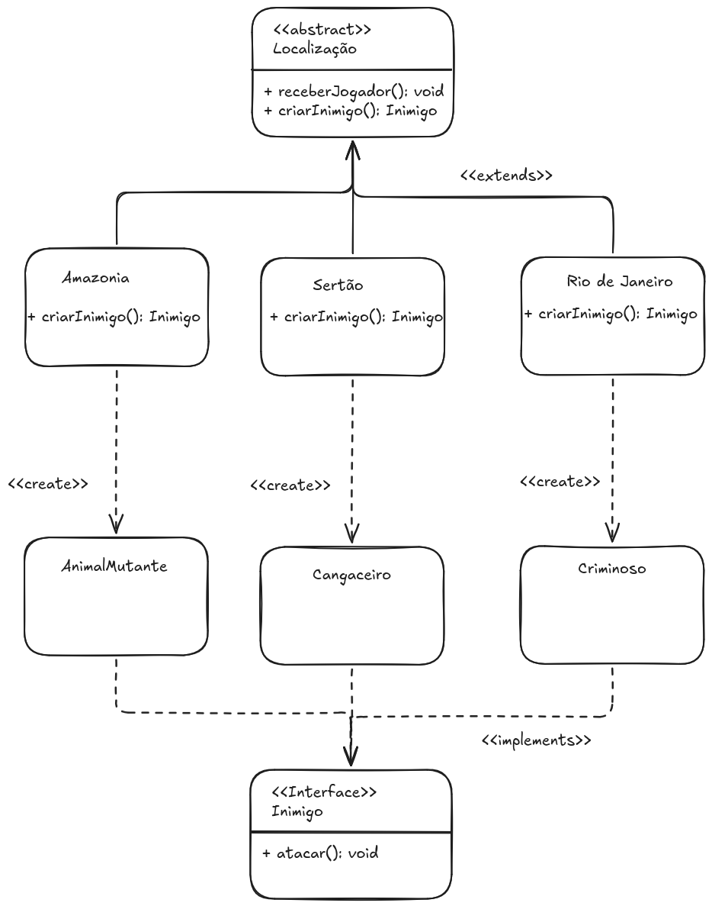

# 🎮 Jogo de Ação Brasileiro - Padrão Factory Method

Este repositório contém a solução para um problema de design de software utilizando o padrão de projeto **Factory Method**. O cenário simula um jogo de ação ambientado em localizações brasileiras, onde cada localização possui inimigos específicos.

## 📝 Prompt Utilizado

Me dê um passo-a-passo de como gerar a solução para o seguinte problema proposto:

Imagine que você está criando um jogo de ação que se passa em localizações brasileiras. As
diferentes localizações terão inimigos diferentes, referentes apenas àquela localização. A
primeira versão do seu jogo era uma demonstração e só tinha uma única localização, a
Amazônia. Na Amazônia, os inimigos que o jogador precisa enfrentar são animais mutantes.
Depois de um tempo, a demonstração do seu jogo se torna bastante popular. A cada dia você
recebe dezenas de pedidos de jogadores para incorporar o Sertão brasileiro no seu jogo.
Portanto, agora você terá que dá suporte a cangaceiros como inimigos também.
Independentemente da localização, seja na Amazônia, ou no Sertão, os inimigos deverão
sempre atacar o jogador que estiver passando por aquela região. Para o jogador do seu jogo,
pouco importa em que localização ele está, o que importa é que há garantia de que haverá
inimigos para enfrentar. No futuro, a localização Rio de Janeiro também poderá ser uma fase
do jogo, apresentado criminosos como inimigos.
• Usando o padrão Factory Method, desenhe um diagrama de classes, codifique e
simule a situação acima.
• Seus artefatos (diagrama, código e simulação) devem ser tão simples quanto possível,
servindo apenas para ilustrar a situação descrita acima com o emprego do padrão de
projeto solicitado.


## 📊 Diagrama de Classes



## 🛠️ Tecnologias Utilizadas

- **Java** (JDK 17 ou superior)
- **Padrão de Projeto:** Factory Method

## 🚀 Como Executar o Projeto

Para compilar e executar o projeto no terminal (Linux/Ubuntu ou Windows com Git Bash), siga os passos abaixo:

1. **Compile o código fonte:**
   ```bash
   javac JogoFactoryMethodDemo.java